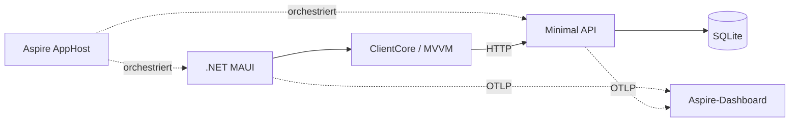
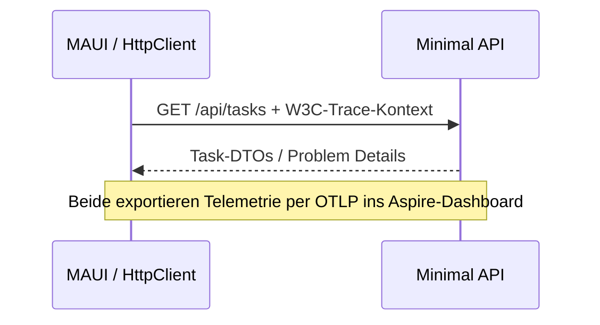

<div class="tsj-kicker">Markdown / Developer Experience / KI</div>

# Dein nächster Talk<br>ist ein Git-Repo.

Entdecke **Slidev**. Erzähle die Geschichte eines echten .NET MAUI + Aspire-Projekts mit Markdown, animiertem Code und deinem eigenen Design.

<div class="tsj-chips"><span>.NET 10</span><span>.NET MAUI</span><span>Aspire</span><span>Slidev</span></div>

::right::

<div class="tsj-terminal">
  <div class="tsj-terminal-bar"><i></i><i></i><i></i></div>
  <div class="tsj-terminal-muted">decks/de.md</div>
  <div class="tsj-terminal-accent"># Slides als Code.</div>
  <div>Schreiben. Committen. Präsentieren.</div>
  <hr>
  <div class="tsj-terminal-muted">$ npm run dev</div>
  <div class="tsj-terminal-accent">Markdown → ein Gespräch</div>
</div>

<!--
Mit dem Sprach- und Theme-Schalter starten. Dies ist eine Slidev-Einführung mit dem
TaskBoard als Fallbeispiel, nicht die native App innerhalb einer Präsentation.
-->

---
name: markdown
section: "01 / Warum Slidev?"
---

# Markdown ist die Quelle.

Slides gehören neben den Code, den sie erklären.

<div class="tsj-cards">
  <div class="tsj-card"><span class="tsj-number">01 / VERSIONIEREN</span><h3>Diffs statt Dateien</h3><p>Den Talk im Pull Request prüfen, Ideen verzweigen und die Geschichte mit dem Code aktuell halten.</p></div>
  <div class="tsj-card"><span class="tsj-number">02 / CODE ZEIGEN</span><h3>Für Entwickler</h3><p>Shiki-Highlighting, schrittweise Hervorhebungen, Magic Move, Mermaid und Vue-Komponenten.</p></div>
  <div class="tsj-card"><span class="tsj-number">03 / DESIGN BEHALTEN</span><h3>Dein Theme</h3><p>Layouts, Schriften, Farben und Komponenten für jeden weiteren Talk wiederverwenden.</p></div>
</div>

<div class="tsj-callout">Markdown zuerst. Vue, CSS und Frontmatter, wenn du mehr Kontrolle brauchst.</div>

<!--
Normales Markdown reicht für die Grundlagen. Eigene Layouts und Schalter verwenden
hier Vue/CSS; das komplette Theme ist also nicht ausschließlich Markdown.
-->

---
layout: two-cols
name: syntax
section: "01 / Vom Text zur Folie"
---

# Ein Deck in einer Datei

```md
---
theme: ../themes/tsjdevapps
title: Mein nächster Talk
---

# Hallo, Entwickler!

- In Markdown schreiben
- Mit Git committen

---

# Eine Idee pro Folie
```

::right::

## Markdown. Mit Superkräften.

<v-clicks>

- `---` beginnt die nächste Folie.
- Frontmatter wählt das Layout.
- Code-Fences werden zu hervorgehobenem Code.
- HTML-Kommentare enthalten Sprechernotizen.
- Benannte Slots erzeugen mehrere Spalten.

</v-clicks>

<div class="tsj-note">Auch diese Präsentation ist Markdown, gerendert von Slidev.</div>

---
layout: two-cols
name: taskboard
section: "02 / Das Praxisbeispiel"
---

# Das ist TaskBoard

Native Aufgaben, überschaubarer Stack.

- **.NET MAUI:** Aufgaben bearbeiten und synchronisieren.
- **Minimal API + SQLite:** persistente Aufgaben.
- **Aspire:** Entwicklungs-Orchestrierung.
- **ClientCore:** testbares MVVM + typisiertes HTTP.

<div class="tsj-note">Ohne Docker, Cloud-Ressourcen, Authentifizierung, Cache oder Message Broker.</div>
<a class="tsj-source" href="https://github.com/tsjdev-apps/maui-aspire-taskboard/tree/9f678cd884789a74de4b2561e45d10492dcd4c09">TaskBoard-Quellcode · Revision 9f678cd</a>

::right::

<TaskBoardPreview language="de" />

<!--
Das Board ist ausdrücklich eine Illustration und kein Screenshot der nativen App.
Projektbehauptungen beziehen sich auf die öffentliche Dokumentation und den Quellcode.
-->

---
name: architecture
section: "02 / Architektur statt Boxen um der Boxen willen"
---

# Ein Backend. Ein nativer Client.



<div class="tsj-chips"><span>AppHost: nur Entwicklung</span><span>Contracts: gemeinsame DTOs + Validierung</span><span>Core: unabhängig von MAUI</span></div>

<a class="tsj-source" href="https://github.com/tsjdev-apps/maui-aspire-taskboard/blob/9f678cd884789a74de4b2561e45d10492dcd4c09/docs/architecture.md">Quelle: docs/architecture.md · vereinfachtes Abhängigkeitsdiagramm</a>

<!--
Die Telemetrie-Pfeile stehen für ServiceDefaults und MauiServiceDefaults, die zugunsten
der Lesbarkeit fehlen. Aspire ersetzt nicht die Laufzeitarchitektur der App.
-->

---
layout: code
name: apphost
section: "02 / Code, der eine Geschichte erzählt"
---

# Der AppHost wächst

````md magic-move [AppHost.cs] {duration:700}
```csharp
var builder =
    DistributedApplication.CreateBuilder(args);

builder.Build().Run();
```
```csharp
var builder =
    DistributedApplication.CreateBuilder(args);
var api = builder
    .AddProject<Projects.TaskBoard_Api>("taskapi")
    .WithHttpHealthCheck("/health");

builder.Build().Run();
```
```csharp
var builder =
    DistributedApplication.CreateBuilder(args);
var api = builder
    .AddProject<Projects.TaskBoard_Api>("taskapi")
    .WithHttpHealthCheck("/health");
var maui = builder.AddMauiProject("taskboard",
    "../TaskBoard.Maui/TaskBoard.Maui.csproj");
if (OperatingSystem.IsWindows())
{
    maui.AddWindowsDevice().WithReference(api);
}
builder.Build().Run();
```
````

<a class="tsj-source" href="https://github.com/tsjdev-apps/maui-aspire-taskboard/blob/9f678cd884789a74de4b2561e45d10492dcd4c09/src/TaskBoard.AppHost/AppHost.cs">Quelle: AppHost.cs · gekürzter Desktop-Ausschnitt, neu formatiert</a>

::right::

## Lass den Code bewegen.

<div class="tsj-step-list"><div class="tsj-step">Mit dem Host beginnen.</div><div class="tsj-step">API + Health Check ergänzen.</div><div class="tsj-step">Den nativen Client verbinden.</div></div>

<div class="tsj-note">Zweimal → drücken. Shiki Magic Move animiert die Tokens zwischen den Schritten.</div>
<div class="tsj-note">Die ersten Schritte sind Lehrbeispiele. Im letzten fehlt das Mac-/Mobile-Setup.</div>

<!--
Zweimal weiterklicken, um echte Token-Animationen zu zeigen. AddMauiProject erhält
einen csproj-Pfad, keine Projektreferenz. Der letzte Schritt entspricht dem Desktop-Ausschnitt.
-->

---
layout: code
name: discovery
section: "02 / Endpoints konfigurieren"
---

# Finden oder konfigurieren

```csharp {1-3|4-6|*} [MauiProgram.cs]
var hasDiscoveredApi = builder.Configuration
    .GetSection("services:taskapi")
    .GetChildren().Any();
var baseAddress = hasDiscoveredApi
    ? new Uri("https+http://taskapi")
    : GetStandaloneAddress(
        builder.Configuration["TaskBoard:ApiBaseUrl"]);
builder.Services.AddTaskBoardClient(baseAddress);
```

<a class="tsj-source" href="https://github.com/tsjdev-apps/maui-aspire-taskboard/blob/9f678cd884789a74de4b2561e45d10492dcd4c09/src/TaskBoard.Maui/MauiProgram.cs">Quelle: MauiProgram.cs · Ausschnitt, neu formatiert</a>

::right::

## Ein Client. Zwei Startwege.

- Aspire liefert `services:taskapi`.
- Discovery löst `https+http://taskapi` auf.
- Ohne AppHost gilt eine validierte HTTP(S)-URL.

<div class="tsj-callout">Ein separat gestarteter Client erbt nicht automatisch die AppHost-Konfiguration.</div>

<!--
Zuerst Discovery hervorheben, danach die Adresse. https+http ist ein Discovery-Schema,
keine öffentliche URL. Der Fallback validiert ausdrücklich, statt still etwas zu erraten.
-->

---
layout: code
name: mobile
section: "02 / Mobile ist nicht localhost"
---

# Ein Tunnel mit Absicht

```csharp {1|3-5|*} [AppHost.cs]
if (builder.Environment.IsDevelopment())
{
    var tunnel = builder
        .AddDevTunnel("taskapi-tunnel")
        .WithAnonymousAccess()
        .WithReference(api.GetEndpoint("https"));
}
```

<a class="tsj-source" href="https://github.com/tsjdev-apps/maui-aspire-taskboard/blob/9f678cd884789a74de4b2561e45d10492dcd4c09/src/TaskBoard.AppHost/AppHost.cs">Quelle: AppHost.cs · Tunnel-Ausschnitt; übrige Registrierungen fehlen</a>

<div class="tsj-callout">Anonymer Zugriff macht die Entwicklungs-API öffentlich. Nicht als Produktions-Authentifizierung oder mit sensiblen Daten verwenden.</div>

::right::

## Den Host erreichen.

- Desktop verbindet sich direkt.
- Android / unterstützte iOS-Ziele referenzieren den API-Tunnel.
- `WithOtlpDevTunnel()` transportiert Telemetrie.
- Gemeinsame Callbacks starten Tunnel bei Bedarf.

<div class="tsj-note">Beim normalen Desktop-Start bleibt jeder öffentliche Tunnel aus. Host-OS und Development-Prüfungen begrenzen die Ziele.</div>

---
layout: code
name: resilience
section: "02 / Fehler sichtbar machen"
---

# Retries nur für GET

```csharp {1-5|6-10|*} [ClientServiceCollectionExtensions.cs]
http.AddStandardResilienceHandler(options =>
{
    options.TotalRequestTimeout.Timeout =
        TimeSpan.FromSeconds(12);
    options.AttemptTimeout.Timeout = TimeSpan.FromSeconds(3);
    options.Retry.MaxRetryAttempts = 2;
    options.Retry.Delay = TimeSpan.FromMilliseconds(500);
    options.Retry.BackoffType = DelayBackoffType.Constant;
    options.Retry.UseJitter = false;
    options.Retry.DisableFor(HttpMethod.Post, HttpMethod.Put,
        HttpMethod.Delete, HttpMethod.Patch);
    configureResilience?.Invoke(options);
});
```

<a class="tsj-source" href="https://github.com/tsjdev-apps/maui-aspire-taskboard/blob/9f678cd884789a74de4b2561e45d10492dcd4c09/src/TaskBoard.ClientCore/DependencyInjection/ClientServiceCollectionExtensions.cs">Quelle: ClientServiceCollectionExtensions.cs · Ausschnitt, neu formatiert</a>

::right::

## Eine bewusste Policy

- GET: höchstens **zwei Retries** bei transienten Fehlern.
- Schreiben: **keine automatischen Retries**.
- Ein Versuch: **3 Sekunden**.
- Pipeline-Budget: **12 Sekunden**.

<div class="tsj-note">Der Quellcode setzt danach auch HttpClient.Timeout, um das Puffern des Response-Bodys zu begrenzen.</div>

<!--
Zwei Retries bedeuten bis zu drei Versuche. Ein Retry nach einem Schreib-Timeout
kann eine Operation duplizieren. Diese Policy ist eine Beispielentscheidung, kein Standard für alles.
-->

---
layout: code
name: mvvm
section: "02 / UI-Logik testbar halten"
---

# Kleine MVVM-Bausteine

```csharp [TasksViewModel.cs]
[ObservableProperty]
private bool _isRefreshing;

[RelayCommand]
private Task AddAsync() =>
    ExecuteAsync(_ => navigation.ShowEditorAsync(null),
        CancellationToken.None);
```

<a class="tsj-source" href="https://github.com/tsjdev-apps/maui-aspire-taskboard/blob/9f678cd884789a74de4b2561e45d10492dcd4c09/src/TaskBoard.ClientCore/ViewModels/TasksViewModel.cs">Quelle: TasksViewModel.cs · zwei Ausschnitte, neu formatiert</a>

::right::

## Native UI. Normale Tests.

- Toolkit generiert Properties und Commands.
- Interfaces kapseln Navigation und HTTP.
- `ExecuteAsync` schützt die Operationsgrenze.
- xUnit-Tests brauchen keine laufende MAUI-UI.

<div class="tsj-callout">Bei Refresh-Fehlern bleiben Aufgaben und letzter Sync-Zeitpunkt erhalten.</div>

---
layout: two-cols
name: observability
section: "02 / Ein Plan für die Live-Demo"
---

# Ein Request. Ein Trace.



<div class="tsj-note">Demo-Vorschlag für die echte App. Die Slides starten TaskBoard nicht und rufen dessen API nicht auf.</div>

::right::

<div class="tsj-demo-cards">
  <div class="tsj-card"><h3>01 / Refresh</h3><p>Das Board aktualisieren und den Client-/Server-Trace im Dashboard finden.</p></div>
  <div class="tsj-card"><h3>02 / Verzögerung</h3><p>Auf der Diagnoseseite mit Development /api/demo/slow die Laufzeit prüfen.</p></div>
  <div class="tsj-card"><h3>03 / Fehler</h3><p>Development /api/demo/fail aufrufen: 503, begrenzte Retries und lokalisierte Fehlermeldung beobachten.</p></div>
</div>

<!--
Die Anwendung muss separat eingerichtet und gestartet werden. Dieses Slides-Projekt
enthält weder eine laufende App noch künstliche Dashboard-Screenshots.
-->

---
layout: two-cols
name: magic-move
section: "03 / Die Animationssyntax"
---

# Vier Backticks. Magie.

`````md
````md magic-move
```csharp
var app = builder.Build();
app.Run();
```
```csharp
var app = builder.Build();
app.MapTaskEndpoints();
app.Run();
```
````
`````

<div class="tsj-note">Außen vier Backticks, innen drei. Jeder Codeblock ist ein Schritt.</div>

::right::

## Das gerenderte Ergebnis.

````md magic-move {duration:700}
```csharp
var app = builder.Build();
app.Run();
```
```csharp
var app = builder.Build();
app.MapTaskEndpoints();
app.Run();
```
````

<div class="tsj-callout">Mit → die Endpoint-Registrierung durch eine echte Token-Animation einfügen.</div>
<div class="tsj-note">Lehrbeispiel, nicht das komplette API-Startup. Normales Line-Highlighting lässt sich ergänzend nutzen.</div>

---
name: ai
section: "03 / KI unterstützt, Menschen prüfen"
---

# Gib KI Kontext. Behalte die Kontrolle.

<div class="tsj-chips"><span>1. Quellcode lesen</span><span>2. Gliederung entwerfen</span><span>3. Markdown generieren</span><span>4. Bauen + prüfen</span></div>

```text
Erstelle einen Slidev-Talk zur verlinkten TaskBoard-Revision.
Nutze tsjdevapps und gleiche Folien-IDs für Deutsch/Englisch.
Eine Idee pro Folie; kurze Snippets mit Link zur Quelle.
Zeige den AppHost in einer dreistufigen magic-move-Animation.
Erfinde keine APIs, Messwerte, Screenshots oder Deployments.
Kennzeichne Vereinfachungen und ergänze Sprechernotizen.
```

<div class="tsj-callout">KI entwirft die Geschichte. Du prüfst Code, Übersetzungen, Kontrast und gerenderte Folien.</div>
<div class="tsj-note">Nur freigegebenen Quellcode teilen. Zugangsdaten, personenbezogene Daten und private URLs vor der Übergabe an ein KI-Tool entfernen.</div>

<!--
Markdown macht KI-gestützte Änderungen bequem und reviewbar, nicht automatisch
inhaltlich korrekt. Mit dem referenzierten Quellcode abgleichen und visuell prüfen.
-->

---
layout: two-cols
name: theme
section: "03 / Das Design wiederverwenden"
---

# Ein Theme. Viele Talks.

```text
themes/tsjdevapps/
  package.json
  components/
    SlideFrame.vue
    DeckControls.vue
  layouts/
    cover.vue
    default.vue
    two-cols.vue
    code.vue
  setup/shiki.ts
  styles/
```

::right::

## Inhalt bleibt unabhängig.

```yaml
theme: ../themes/tsjdevapps
layout: cover
title: Mein nächster Entwickler-Talk
themeConfig:
  language: de
```

- Lokal nutzbar, kein Registry-Publishing nötig.
- Fonts werden lokal gebündelt.
- Paketname: `slidev-theme-tsjdevapps`.

<div class="tsj-note">Das Theme enthält Branding, keine TaskBoard-Inhalte. Sprachlinks sind optionale Konfiguration.</div>

---
name: color-modes
section: "03 / Eine Marke, zwei Erscheinungsbilder"
---

# Hell oder dunkel? Du entscheidest.

<div class="tsj-columns">
  <div class="tsj-palette tsj-palette-light"><h3>Light / warmes Papier</h3><p>Off-White, dunkle Schrift und tiefes Teal.</p><div class="tsj-swatches"><span style="background:#f5efe7"></span><span style="background:#fffdf9"></span><span style="background:#00695c"></span><span style="background:#1f2933"></span></div><p>Papier #fffdf9 · Akzenttext #00695c</p></div>
  <div class="tsj-palette tsj-palette-dark"><h3>Dark / Midnight Teal</h3><p>Blauschwarze Flächen, helle Schrift und Mint.</p><div class="tsj-swatches"><span style="background:#0f1720"></span><span style="background:#16212b"></span><span style="background:#6ee7d2"></span><span style="background:#eef4f3"></span></div><p>Papier #16212b · Akzenttext #6ee7d2</p></div>
</div>

<div class="tsj-callout">Probiere den Schalter oben rechts. Slidev merkt sich deine Wahl und passt auch Code-Highlighting an.</div>
<div class="tsj-note">Palette und Schriften orientieren sich an tsjdev-apps.de. Theme und Folienposition bleiben beim EN-/DE-Wechsel erhalten.</div>

---
layout: code
name: workflow
section: "04 / Lokal starten"
---

# Vom Clone auf die Bühne

```powershell
$repo = "https://github.com/tsjdev-apps/"
git clone "${repo}maui-aspire-taskboard-slides.git"
cd maui-aspire-taskboard-slides
npm ci
npm run dev

npm run build
npm run preview
npm run export:de
```

::right::

## Für die Slides genügt Node.js.

- Node **22.12+**, am besten Node 24 LTS.
- EN: `localhost:3030/en/`
- DE: `localhost:3031/de/`
- Build-Vorschau: `localhost:4173/`

<div class="tsj-note">Zum Präsentieren sind weder .NET SDK noch MAUI-Workloads nötig. PDF-Export braucht Playwright-Chromium.</div>
<div class="tsj-note">export:en erzeugt Englisch, die :dark-Varianten dunkle PDFs. Statische Exporte enthalten keine Animationen.</div>

---
name: presenting
section: "04 / Die Geschichte statt der Tools präsentieren"
---

# Die spannenden Momente proben.

<div class="tsj-cards">
  <div class="tsj-card"><span class="tsj-number">01 / NAVIGIEREN</span><h3>Ein Klick pro Schritt</h3><p>Pfeiltasten führen durch Code-Hervorhebungen und Magic Move, bevor die nächste Folie erscheint.</p></div>
  <div class="tsj-card"><span class="tsj-number">02 / PRÄSENTIEREN</span><h3>Toolbar nutzen</h3><p>Presenter-Ansicht für Notizen, Overview zur Orientierung und Fullscreen für das Publikum.</p></div>
  <div class="tsj-card"><span class="tsj-number">03 / TEILEN</span><h3>Interaktiv bleiben</h3><p>Das gebaute Web-Deck behält Animationen und Schalter. PDF ist ein statisches Handout.</p></div>
</div>

<div class="tsj-callout">Probe: AppHost erweitern → Retries hervorheben → Theme wechseln → Sprache wechseln.</div>
<div class="tsj-note">Öffentliche Builds lassen Notizen weg. --with-clicks nimmt beim PDF-Export auch Code-Zwischenschritte auf.</div>

---
layout: cover
name: resources
section: "04 / Dein nächster Schritt"
---

<div class="tsj-kicker">Schreiben. Committen. Präsentieren.</div>

# Weniger schieben.<br>Mehr erzählen.

Beginne mit dem Code. Halte den Inhalt in Markdown. Überlass das visuelle Design deinem Theme.

<div class="tsj-chips"><span>EN / DE</span><span>Light / Dark</span><span>Wiederverwendbares tsjdevapps-Theme</span></div>

::right::

<div class="tsj-card">
  <h3>Dein nächster Talk</h3>
  <p><a href="https://sli.dev/">Slidev-Dokumentation</a></p><br>
  <p><a href="https://github.com/tsjdev-apps/maui-aspire-taskboard">Das .NET MAUI + Aspire TaskBoard</a></p><br>
  <p><a href="https://github.com/tsjdev-apps/maui-aspire-taskboard-slides">Diese Slides + das Theme</a></p><br>
  <p><a href="https://medium.com/@tsjdevapps">Medium / @tsjdevapps</a></p>
</div>

<!--
Zum Kopieren eines Decks und Wiederverwenden des Themes einladen. Alle Projekt-Snippets
beziehen sich auf Revision 9f678cd. Unter blogs/ stehen Setup, Reuse, Export und KI-Beispiele.
-->
