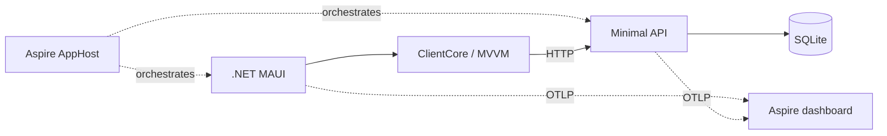
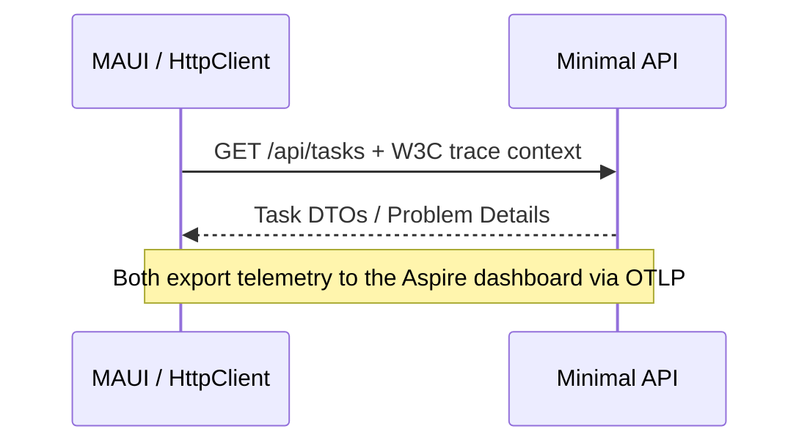

<div class="tsj-kicker">Markdown / Developer experience / AI</div>

# Your next talk<br>is a Git repo.

Meet **Slidev**. Tell the story of a real .NET MAUI + Aspire project with Markdown, animated code, and your own visual identity.

<div class="tsj-chips"><span>.NET 10</span><span>.NET MAUI</span><span>Aspire</span><span>Slidev</span></div>

::right::

<div class="tsj-terminal">
  <div class="tsj-terminal-bar"><i></i><i></i><i></i></div>
  <div class="tsj-terminal-muted">decks/en.md</div>
  <div class="tsj-terminal-accent"># Slides as code.</div>
  <div>Write. Commit. Present.</div>
  <hr>
  <div class="tsj-terminal-muted">$ npm run dev</div>
  <div class="tsj-terminal-accent">Markdown → a conversation</div>
</div>

<!--
Open with the language and appearance controls. This is a Slidev introduction using
TaskBoard as a real case study, not a claim that the native app runs inside these slides.
-->

---
name: markdown
section: "01 / Why Slidev?"
---

# Markdown is the source.

Slides belong next to the code they explain.

<div class="tsj-cards">
  <div class="tsj-card"><span class="tsj-number">01 / VERSION IT</span><h3>Diffs, not files</h3><p>Review a talk in a pull request. Branch ideas. Keep the story aligned with your implementation.</p></div>
  <div class="tsj-card"><span class="tsj-number">02 / SHOW CODE</span><h3>Built for devs</h3><p>Shiki highlighting, line-by-line reveals, Magic Move, Mermaid, and Vue components.</p></div>
  <div class="tsj-card"><span class="tsj-number">03 / OWN THE DESIGN</span><h3>Your theme</h3><p>Reuse layouts, typography, colors, and components across every future deck.</p></div>
</div>

<div class="tsj-callout">Markdown first. Vue, CSS, and frontmatter when you need more control.</div>

<!--
Plain Markdown covers the basics. Custom layouts and controls in this repository use
Vue/CSS; do not describe the entire theme implementation as pure Markdown.
-->

---
layout: two-cols
name: syntax
section: "01 / From text to slides"
---

# A deck in one file

```md
---
theme: ../themes/tsjdevapps
title: My next talk
---

# Hello, developers!

- Write in Markdown
- Commit with Git

---

# One idea per slide
```

::right::

## Markdown. With superpowers.

<v-clicks>

- `---` starts the next slide.
- Frontmatter selects a layout.
- Code fences become highlighted code.
- Speaker notes live in HTML comments.
- Named slots create multi-column layouts.

</v-clicks>

<div class="tsj-note">This very presentation is Markdown, rendered by Slidev.</div>

---
layout: two-cols
name: taskboard
section: "02 / The real-world example"
---

# Meet TaskBoard

A native task board with a deliberately small, inspectable stack.

- **.NET MAUI:** create, edit, complete, delete, refresh.
- **Minimal API + SQLite:** persistent tasks.
- **Aspire:** development orchestration.
- **ClientCore:** testable MVVM + typed HTTP.

<div class="tsj-note">No Docker, cloud resources, authentication, cache, or message broker in this sample.</div>
<a class="tsj-source" href="https://github.com/tsjdev-apps/maui-aspire-taskboard/tree/9f678cd884789a74de4b2561e45d10492dcd4c09">TaskBoard source · revision 9f678cd</a>

::right::

<TaskBoardPreview language="en" />

<!--
The board is an explicitly labeled illustration, not a screenshot of the native app.
The public project's documentation and source are the reference for all project claims.
-->

---
name: architecture
section: "02 / Architecture, not boxes for their own sake"
---

# One backend. One native client.



<div class="tsj-chips"><span>AppHost: development only</span><span>Contracts: shared DTOs + validation</span><span>Core: no MAUI dependency</span></div>

<a class="tsj-source" href="https://github.com/tsjdev-apps/maui-aspire-taskboard/blob/9f678cd884789a74de4b2561e45d10492dcd4c09/docs/architecture.md">Source: docs/architecture.md · simplified dependency diagram</a>

<!--
The telemetry arrows represent ServiceDefaults and MauiServiceDefaults; those projects
are omitted for readability. Aspire does not replace the app's runtime architecture.
-->

---
layout: code
name: apphost
section: "02 / Code that tells a story"
---

# Grow the AppHost

````md magic-move [AppHost.cs] {duration:700}
```csharp
var builder =
    DistributedApplication.CreateBuilder(args);

builder.Build().Run();
```
```csharp
var builder =
    DistributedApplication.CreateBuilder(args);
var api = builder
    .AddProject<Projects.TaskBoard_Api>("taskapi")
    .WithHttpHealthCheck("/health");

builder.Build().Run();
```
```csharp
var builder =
    DistributedApplication.CreateBuilder(args);
var api = builder
    .AddProject<Projects.TaskBoard_Api>("taskapi")
    .WithHttpHealthCheck("/health");
var maui = builder.AddMauiProject("taskboard",
    "../TaskBoard.Maui/TaskBoard.Maui.csproj");
if (OperatingSystem.IsWindows())
{
    maui.AddWindowsDevice().WithReference(api);
}
builder.Build().Run();
```
````

<a class="tsj-source" href="https://github.com/tsjdev-apps/maui-aspire-taskboard/blob/9f678cd884789a74de4b2561e45d10492dcd4c09/src/TaskBoard.AppHost/AppHost.cs">Source: AppHost.cs · shortened desktop excerpt, reformatted</a>

::right::

## Let the code move.

<div class="tsj-step-list"><div class="tsj-step">Start with the host.</div><div class="tsj-step">Register the API + health check.</div><div class="tsj-step">Connect the native client.</div></div>

<div class="tsj-note">Press → twice. Shiki Magic Move morphs tokens between steps.</div>
<div class="tsj-note">First steps are teaching examples. The final step omits Mac/mobile setup.</div>

<!--
Advance twice to demonstrate actual token-level animation. AddMauiProject uses a csproj
path, not a project reference. The final step preserves the desktop source behavior.
-->

---
layout: code
name: discovery
section: "02 / Endpoint configuration"
---

# Discover, or configure

```csharp {1-3|4-6|*} [MauiProgram.cs]
var hasDiscoveredApi = builder.Configuration
    .GetSection("services:taskapi")
    .GetChildren().Any();
var baseAddress = hasDiscoveredApi
    ? new Uri("https+http://taskapi")
    : GetStandaloneAddress(
        builder.Configuration["TaskBoard:ApiBaseUrl"]);
builder.Services.AddTaskBoardClient(baseAddress);
```

<a class="tsj-source" href="https://github.com/tsjdev-apps/maui-aspire-taskboard/blob/9f678cd884789a74de4b2561e45d10492dcd4c09/src/TaskBoard.Maui/MauiProgram.cs">Source: MauiProgram.cs · excerpt, reformatted</a>

::right::

## Same client. Two launches.

- Aspire supplies `services:taskapi`.
- Discovery resolves `https+http://taskapi`.
- Standalone launch uses a validated HTTP(S) URL.

<div class="tsj-callout">A client launched independently does not automatically inherit AppHost configuration.</div>

<!--
Highlight discovery first, then the address selection. https+http is a discovery
scheme, not a literal public URL. The fallback is explicit validation, not silent guessing.
-->

---
layout: code
name: mobile
section: "02 / Mobile is not localhost"
---

# A tunnel, with intent

```csharp {1|3-5|*} [AppHost.cs]
if (builder.Environment.IsDevelopment())
{
    var tunnel = builder
        .AddDevTunnel("taskapi-tunnel")
        .WithAnonymousAccess()
        .WithReference(api.GetEndpoint("https"));
}
```

<a class="tsj-source" href="https://github.com/tsjdev-apps/maui-aspire-taskboard/blob/9f678cd884789a74de4b2561e45d10492dcd4c09/src/TaskBoard.AppHost/AppHost.cs">Source: AppHost.cs · tunnel excerpt; other registrations omitted</a>

<div class="tsj-callout">Anonymous access exposes the development API. Never use this as production authentication or with sensitive data.</div>

::right::

## Reach the host.

- Desktop connects directly.
- Android / supported iOS targets reference the API tunnel.
- `WithOtlpDevTunnel()` carries telemetry.
- Shared callbacks start tunnels on demand.

<div class="tsj-note">Default desktop startup opens no public tunnel. Host OS and development checks gate the targets.</div>

---
layout: code
name: resilience
section: "02 / Make failure visible"
---

# Retry reads, not writes

```csharp {1-5|6-10|*} [ClientServiceCollectionExtensions.cs]
http.AddStandardResilienceHandler(options =>
{
    options.TotalRequestTimeout.Timeout =
        TimeSpan.FromSeconds(12);
    options.AttemptTimeout.Timeout = TimeSpan.FromSeconds(3);
    options.Retry.MaxRetryAttempts = 2;
    options.Retry.Delay = TimeSpan.FromMilliseconds(500);
    options.Retry.BackoffType = DelayBackoffType.Constant;
    options.Retry.UseJitter = false;
    options.Retry.DisableFor(HttpMethod.Post, HttpMethod.Put,
        HttpMethod.Delete, HttpMethod.Patch);
    configureResilience?.Invoke(options);
});
```

<a class="tsj-source" href="https://github.com/tsjdev-apps/maui-aspire-taskboard/blob/9f678cd884789a74de4b2561e45d10492dcd4c09/src/TaskBoard.ClientCore/DependencyInjection/ClientServiceCollectionExtensions.cs">Source: ClientServiceCollectionExtensions.cs · excerpt, reformatted</a>

::right::

## A deliberate policy

- GET: at most **two retries** for transient failures.
- Writes: **no automatic retries**.
- Attempt: **3 seconds**.
- Total pipeline budget: **12 seconds**.

<div class="tsj-note">The source also sets HttpClient.Timeout afterward to bound response-body buffering.</div>

<!--
Two retries means up to three attempts, not two requests. Retrying a write after a
timeout can duplicate an operation. These are the sample's choices, not universal defaults.
-->

---
layout: code
name: mvvm
section: "02 / Keep UI logic testable"
---

# Small MVVM building blocks

```csharp [TasksViewModel.cs]
[ObservableProperty]
private bool _isRefreshing;

[RelayCommand]
private Task AddAsync() =>
    ExecuteAsync(_ => navigation.ShowEditorAsync(null),
        CancellationToken.None);
```

<a class="tsj-source" href="https://github.com/tsjdev-apps/maui-aspire-taskboard/blob/9f678cd884789a74de4b2561e45d10492dcd4c09/src/TaskBoard.ClientCore/ViewModels/TasksViewModel.cs">Source: TasksViewModel.cs · two excerpts, reformatted</a>

::right::

## Native UI. Plain tests.

- Toolkit-generated properties and commands.
- Interfaces hide navigation and HTTP details.
- `ExecuteAsync` is the guarded operation boundary.
- xUnit tests need no running MAUI UI.

<div class="tsj-callout">Failed refreshes retain the previous task collection and sync timestamp.</div>

---
layout: two-cols
name: observability
section: "02 / A live-demo plan"
---

# Follow a request



<div class="tsj-note">Suggested demo in the actual app. These slides do not start TaskBoard or call its API.</div>

::right::

<div class="tsj-demo-cards">
  <div class="tsj-card"><h3>01 / Refresh</h3><p>Refresh the board. Find its client/server trace in the dashboard.</p></div>
  <div class="tsj-card"><h3>02 / Delay</h3><p>Use the diagnostics page and Development /api/demo/slow to inspect timing.</p></div>
  <div class="tsj-card"><h3>03 / Failure</h3><p>Call Development /api/demo/fail. Observe 503, bounded retries, and a localized error.</p></div>
</div>

<!--
Requires separately setting up and starting the source application. No application
runtime or synthetic dashboard screenshots are included in the presentation project.
-->

---
layout: two-cols
name: magic-move
section: "03 / The animation syntax"
---

# Four backticks. Magic.

`````md
````md magic-move
```csharp
var app = builder.Build();
app.Run();
```
```csharp
var app = builder.Build();
app.MapTaskEndpoints();
app.Run();
```
````
`````

<div class="tsj-note">Outer fence: four backticks. Inner fences: three. Each code block is one step.</div>

::right::

## This is the rendered result.

````md magic-move {duration:700}
```csharp
var app = builder.Build();
app.Run();
```
```csharp
var app = builder.Build();
app.MapTaskEndpoints();
app.Run();
```
````

<div class="tsj-callout">Press → to insert the endpoint registration with a real token transition.</div>
<div class="tsj-note">Teaching example, not the complete API startup. Pair this with ordinary line highlighting, as shown earlier.</div>

---
name: ai
section: "03 / AI-assisted, human-reviewed"
---

# Give AI context. Keep authorship.

<div class="tsj-chips"><span>1. Read the source</span><span>2. Draft an outline</span><span>3. Generate Markdown</span><span>4. Build + inspect</span></div>

```text
Create a Slidev talk from the linked TaskBoard source revision.
Use the tsjdevapps theme and matching English/German slide IDs.
One idea per slide; keep snippets short and link their source.
Include a three-step AppHost magic-move animation.
Do not invent APIs, metrics, screenshots, or deployment features.
Mark every simplification and add speaker notes.
```

<div class="tsj-callout">AI drafts the story. You verify the code, translations, contrast, and rendered slides.</div>
<div class="tsj-note">Use only source you are allowed to share. Remove credentials, personal data, and private URLs before sending context to an AI tool.</div>

<!--
Markdown makes AI-assisted edits convenient and reviewable. It does not make generated
technical claims correct. Verify against the pinned source and visually inspect the result.
-->

---
layout: two-cols
name: theme
section: "03 / Reuse the identity"
---

# One theme. Many talks.

```text
themes/tsjdevapps/
  package.json
  components/
    SlideFrame.vue
    DeckControls.vue
  layouts/
    cover.vue
    default.vue
    two-cols.vue
    code.vue
  setup/shiki.ts
  styles/
```

::right::

## Content stays separate.

```yaml
theme: ../themes/tsjdevapps
layout: cover
title: My next developer talk
themeConfig:
  language: en
```

- Local theme, no registry publishing needed.
- Fonts bundled locally, not fetched at runtime.
- Package it as `slidev-theme-tsjdevapps`.

<div class="tsj-note">The theme contains branding, not TaskBoard content. Language links are optional configuration.</div>

---
name: color-modes
section: "03 / Same brand, two appearances"
---

# Light or dark? Your audience decides.

<div class="tsj-columns">
  <div class="tsj-palette tsj-palette-light"><h3>Light / warm paper</h3><p>Off-white surfaces. Dark ink. Deep teal text.</p><div class="tsj-swatches"><span style="background:#f5efe7"></span><span style="background:#fffdf9"></span><span style="background:#00695c"></span><span style="background:#1f2933"></span></div><p>Paper #fffdf9 · Accent text #00695c</p></div>
  <div class="tsj-palette tsj-palette-dark"><h3>Dark / midnight teal</h3><p>Blue-black surfaces. Light ink. Mint accents.</p><div class="tsj-swatches"><span style="background:#0f1720"></span><span style="background:#16212b"></span><span style="background:#6ee7d2"></span><span style="background:#eef4f3"></span></div><p>Paper #16212b · Accent text #6ee7d2</p></div>
</div>

<div class="tsj-callout">Try the top-right switch. Slidev remembers your choice; code highlighting changes too.</div>
<div class="tsj-note">Palette and typography inspired by tsjdev-apps.de. Appearance and slide position survive the EN / DE switch.</div>

---
layout: code
name: workflow
section: "04 / Run it locally"
---

# From clone to stage

```powershell
$repo = "https://github.com/tsjdev-apps/"
git clone "${repo}maui-aspire-taskboard-slides.git"
cd maui-aspire-taskboard-slides
npm ci
npm run dev

npm run build
npm run preview
npm run export:en
```

::right::

## Just Node.js for the slides.

- Node **22.12+**, preferably Node 24 LTS.
- EN: `localhost:3030/en/`
- DE: `localhost:3031/de/`
- Built preview: `localhost:4173/`

<div class="tsj-note">No .NET SDK or MAUI workload needed to present. PDF export needs Playwright's Chromium.</div>
<div class="tsj-note">Use npm run export:de for German, or the :dark variants. Static exports cannot preserve animations.</div>

---
name: presenting
section: "04 / Present the story, not the tooling"
---

# Rehearse the interesting moments.

<div class="tsj-cards">
  <div class="tsj-card"><span class="tsj-number">01 / NAVIGATE</span><h3>One click at a time</h3><p>Arrow keys move through code highlights and Magic Move steps before changing slides.</p></div>
  <div class="tsj-card"><span class="tsj-number">02 / PRESENT</span><h3>Use the toolbar</h3><p>Open presenter view for notes, overview for orientation, and fullscreen for the audience.</p></div>
  <div class="tsj-card"><span class="tsj-number">03 / SHARE</span><h3>Keep it interactive</h3><p>A built web deck preserves animations and switches. PDF is a static handout.</p></div>
</div>

<div class="tsj-callout">Rehearsal: grow the AppHost → highlight retries → switch appearance → switch language.</div>
<div class="tsj-note">Public builds omit speaker notes. Add --with-clicks to a PDF export to capture intermediate code steps.</div>

---
layout: cover
name: resources
section: "04 / Take it further"
---

<div class="tsj-kicker">Write. Commit. Present.</div>

# Less dragging.<br>More storytelling.

Start with the code. Keep the content in Markdown. Let your theme do the visual work.

<div class="tsj-chips"><span>EN / DE</span><span>Light / Dark</span><span>Reusable tsjdevapps theme</span></div>

::right::

<div class="tsj-card">
  <h3>Build your next talk</h3>
  <p><a href="https://sli.dev/">Slidev documentation</a></p><br>
  <p><a href="https://github.com/tsjdev-apps/maui-aspire-taskboard">The .NET MAUI + Aspire TaskBoard</a></p><br>
  <p><a href="https://github.com/tsjdev-apps/maui-aspire-taskboard-slides">These slides + the theme</a></p><br>
  <p><a href="https://medium.com/@tsjdevapps">Medium / @tsjdevapps</a></p>
</div>

<!--
Invite people to copy a deck and keep the theme. All project snippets are based on
revision 9f678cd. The guides in blogs/ include setup, reuse, export, and AI prompt examples.
-->
